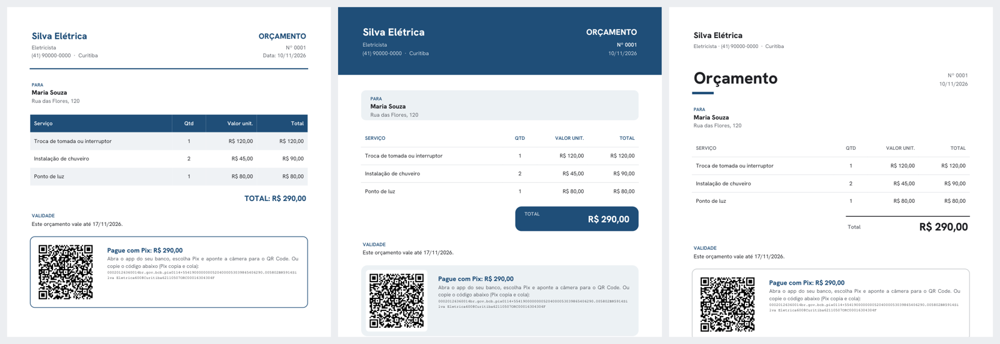

# Bot de Orçamentos por Áudio (MVP)

O prestador de serviço manda um áudio descrevendo o serviço e recebe de volta um orçamento em PDF, com a marca dele, pronto para encaminhar ao cliente.



**Fluxo:** áudio → transcrição → IA identifica cliente, itens e quantidades → preços aplicados a partir da tabela do profissional → resumo para conferência → OK → PDF.

## Em números

- **IA real avaliada, não só simulada:** `avaliar_ia.py` roda 38 frases de prestadores de verdade
  (incluindo correções, preço falado na hora e oficina mecânica) contra o modelo: **36/38 certas,
  0 preço inventado**. O roteador de pedidos livres acertou 12/12 frases vagas.
- **195 testes** automatizados com IA simulada (gratuitos, rodam em ~50 s).
- Telegram + página web do cliente (aprovar com aceite, Pix do sinal, pedir alteração), painel do
  prestador, parcelas, limite do plano grátis, métricas de uso e deploy (systemd, Caddy, backup).
- IA: `gpt-oss-120b` na Groq, saída em JSON Schema.

Cada erro que a avaliação achou virou regra no código ou no prompt e foi medido de novo. Exemplo:
"pro Seu Carlos a pastilha sai 220" estava alterando a tabela de preços do prestador; agora vale só
naquele orçamento (de 1/5 para 4/5 na sonda de oficina).

## Regra de ouro: a IA nunca decide preço

A IA recebe a tabela do profissional **sem os valores** (só id, descrição e sinônimos). Ela devolve apenas *qual item* e *quantos*. Toda a conta é feita em `app/calculo.py`, com os preços do banco. Se aparecer um serviço que não está na tabela, o bot pergunta o valor e guarda para as próximas vezes.

## Ajustes de preço e pedidos do cliente

Antes de gerar o PDF, ou depois de enviado, dá para ajustar tudo falando:

| O que você fala (ou o cliente) | O que acontece |
|---|---|
| "são 8 tomadas", "tira o chuveiro" | muda quantidade / remove item |
| "a fiação faço por 300", "nesse o chuveiro sai 100" | preço ajustado **só neste orçamento** (marcado com ✏️; a tabela não muda) |
| "dá 10% de desconto" | desconto percentual |
| "tira 50 reais" | desconto em R$ |
| "fecha em 700", "consegue fazer por 650?" | o sistema calcula o desconto para chegar no total |
| "tira o desconto" | remove |

**Cliente pediu mudança num orçamento já enviado?** Encaminhe a mensagem ou o áudio dele para o bot (ou diga "no orçamento 3 o cliente quer pagar 600", ou use `/editar 3 dá 10% de desconto`). O bot descobre qual orçamento é (pelo número, pelo nome do cliente ou perguntando), mostra a revisão para você conferir e, no OK, gera o PDF como **revisão 2, 3...** do mesmo número.

A IA continua só *transcrevendo* números que foram falados. Toda conta é feita no código, e nada vai para o cliente sem o seu OK.

## Pix, lembretes e catálogo

- **Pix:** no cadastro (ou com `/pix SUA_CHAVE`) o profissional informa a chave. Cada orçamento sai com **QR Code e Pix copia e cola no valor exato**, no PDF e numa mensagem separada, fácil de encaminhar. O código é gerado localmente, no padrão do Banco Central (`app/pix.py`): sem banco, sem API, sem taxa, e o dinheiro cai direto na conta dele. Se forem 11 dígitos que podem ser CPF ou celular, o bot pergunta em vez de adivinhar.
- **Lembretes de follow-up:** orçamento sem `/aprovado` ou `/recusado` gera um aviso após 3 dias e outro após 7 (configurável), só em horário comercial, já com uma **mensagem pronta para encaminhar ao cliente**. `/adiar N` recomeça a contagem.
- **Catálogo por profissão:** no cadastro, o bot mostra os serviços comuns do ofício (eletricista, encanador, pintor, pedreiro, ar-condicionado, marceneiro, gesseiro, montador) **sem preços** e o profissional responde só os valores, até mesmo "40, 120, 60..." na ordem (`app/catalogo.py`).

## Dinheiro no bolso: pagamentos, resumo e reativação

- **Recebimentos e recibo:** "recebi 300 da Dona Maria" ou `/pago 1 300` registra o pagamento (aceita entrada + restante) e devolve um **recibo em PDF** com valor por extenso, pronto para o cliente. `/areceber` lista o que falta receber.
- **Cobrança:** orçamento aprovado e não quitado gera lembrete após 7 e 15 dias, com **mensagem de cobrança pronta e Pix do saldo**. `/cobrar N` faz isso na hora.
- **Resumo semanal:** toda segunda de manhã chega no chat: orçamentos feitos, aprovados, recebido, a receber, sem resposta e o total recebido no ano, com alerta ao passar de 80% do limite do MEI. `/resumo` mostra na hora.
- **Reativação de clientes:** serviços que se repetem (limpeza de ar a cada 6 meses, caixa d'água, revisão elétrica...) já vêm marcados do catálogo; qualquer item pode ser marcado com `/retorno N meses`. Quando vence o prazo, o bot sugere oferecer de novo e entrega a mensagem pronta. Se o cliente já voltou, não incomoda.

## Estrutura

```
app/
  config.py    configurações (lidas do .env)
  db.py        modelo de dados (SQLAlchemy). Dinheiro em centavos.
  ia.py        transcrição + interpretação (OpenAI, saída em JSON estruturado)
  calculo.py   preços, totais, formatação em R$, leitura de valores digitados
  pdf.py       geração do PDF
  pix.py       Pix copia e cola (BR Code) e QR Code
  catalogo.py  serviços comuns por profissão (sem preços)
  textos.py    textos fixos do bot (ajuste de tom / tradução futura)
  nucleo.py    a conversa toda (cadastro, orçamento, correções, comandos)
bot_telegram.py  adaptador do Telegram
simular.py       conversar pelo terminal, sem Telegram
avaliar_ia.py    mede a taxa de acerto da IA real (casos em tests/casos_ia.json)
tests/           testes com IA simulada (grátis)
```

O `nucleo.py` não sabe de onde vem a mensagem. Para o WhatsApp, basta criar um `bot_whatsapp.py` que recebe o webhook, monta uma `Mensagem` e envia as `Respostas` — nada do núcleo muda.

## Como rodar

**1. Preparar o ambiente** (Python 3.11 ou mais novo)

```bash
python -m venv .venv
# Windows: .venv\Scripts\activate    |   Linux/Mac: source .venv/bin/activate
pip install -r requirements.txt
```

**2. Rodar os testes** (não precisa de chave nenhuma)

```bash
python -m pytest -q
```

**3. Criar as chaves**
- **Telegram (grátis):** no app do Telegram, abra uma conversa com `@BotFather`, mande `/newbot`, escolha nome e usuário. Ele te dá um token.
- **IA, opção gratuita para testar:** crie uma conta na Groq (console.groq.com) e gere uma chave. Use a "Opção A" do `.env.example`. O plano gratuito tem limites de uso, suficiente para desenvolver e testar.
- **IA, opção paga (mais precisa):** chave da OpenAI em platform.openai.com/api-keys, com alguns dólares de crédito (centavos por orçamento). Use a "Opção B".

Copie `.env.example` para `.env` e preencha. Trocar de provedor depois é só mudar o `.env`, sem mexer no código.

**4. Testar pelo terminal (opcional)**

```bash
python simular.py
```

**5. Subir o bot**

```bash
python bot_telegram.py
```

Abra o seu bot no Telegram e mande "oi". Ele faz o cadastro (nome, profissão, telefone, pagamento, tabela de preços) e já está pronto para receber áudios.

## Comandos do bot

| Comando | O que faz |
|---|---|
| (áudio ou texto) | Novo orçamento, ou atualização de preços ("chuveiro agora é 130") |
| (foto) | Salva a logo que vai nos PDFs |
| `/precos` | Mostra a tabela de preços |
| `/remover N` | Remove o item N da tabela |
| `/orcamentos` | Últimos 10 orçamentos |
| `/pdf N` | Reenvia o PDF do orçamento N |
| `/editar N [mudança]` | Altera um orçamento já enviado (gera revisão) |
| (mensagem encaminhada) | Pedido do cliente: o bot aplica no orçamento certo |
| `/aprovado N` / `/recusado N` | Marca o resultado (para os lembretes) |
| `/adiar N` | Adia o lembrete do orçamento N |
| `/pix [chave]` | Mostra, troca ou remove (`/pix remover`) a chave Pix |
| `/pago N [valor]` | Registra recebimento (total ou parcial) e gera o recibo |
| `/recibo N` | Reenvia o último recibo do orçamento N |
| `/areceber` | Lista o que falta receber |
| `/cobrar N` | Mensagem de cobrança pronta, com Pix do saldo |
| `/resumo` | Resumo dos últimos 7 dias |
| `/retorno N meses` | Marca o item N da tabela como recorrente (0 desliga) |
| `/cancelar` | Descarta o orçamento em andamento |

Durante a conferência, qualquer mensagem que não seja OK/CANCELAR é tratada como correção.

## Testes

```bash
python -m pytest -q          # 71 testes, sem chave e sem internet
python avaliar_ia.py         # avalia a IA REAL do seu .env com 33 frases realistas
```

| Arquivo | O que cobre |
|---|---|
| `tests/test_fluxo.py` | Fluxos completos: cadastro, orçamento, correções, revisões, Pix, lembretes, pagamentos, resumo, reativação |
| `tests/test_robustez.py` | IA devolvendo lixo, caindo ou errando; valores absurdos; isolamento entre profissionais |
| `tests/test_pdf_estresse.py` | PDF com dezenas de itens, textos enormes, emoji, logo quebrada, valores altos |
| `tests/test_telegram.py` | Adaptador do Telegram com mensagens simuladas (texto, voz, foto, encaminhada) |
| `tests/test_ia_cliente.py` | Montagem das chamadas à IA, incluindo a garantia de que **os preços nunca são enviados à IA** |
| `tests/test_avaliador.py` | Garante que o `avaliar_ia.py` mede certo |

**Avaliação da IA real (`avaliar_ia.py`):** roda 33 casos realistas (fala hesitante de áudio, número por extenso, "meia dúzia", correções, descontos, pagamentos, mensagem encaminhada do cliente...) e mostra a taxa de acerto, os erros de cada caso e quantas vezes a IA **inventou preço** (o ideal é zero). Use para escolher modelo/provedor (troque no `.env` e rode de novo) e para conferir se uma mudança no prompt melhorou. Os casos ficam em `tests/casos_ia.json`: ao achar uma frase que a IA erra no uso real, adicione lá.

## Status: protótipo funcional

Testado de ponta a ponta pelo autor (áudio real no Telegram, PDF, link do cliente aberto no celular).
Ainda **não está em produção** e não tem usuários. Os arquivos de deploy existem, mas o servidor não.

### Projeção

**Fase 1 — piloto (2 a 3 semanas):** 3 a 5 prestadores reais no plano sem limite. O que decide se
continua são as métricas que o próprio bot já registra (`metricas.py`): quantos fazem o 1º orçamento,
quantos voltam numa 2ª semana, % de orçamentos gerados sem correção, % de links abertos e aprovados
pelo cliente.

**Fase 2 — se o piloto mostrar uso espontâneo:** servidor 24h, IA paga com teto de gasto, adaptador
do WhatsApp (o núcleo já não depende do Telegram) e nome/domínio próprios.

**Fase 3 — produto:** assinatura com plano gratuito limitado, e recursos escolhidos pelo que os
prestadores pedirem: agenda por voz, pedido de avaliação após o serviço, registro de gastos por áudio.

Nada da fase 2 em diante é construído antes da fase 1 responder.
